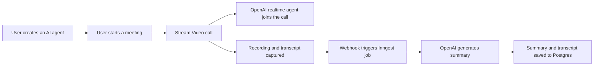

# Meet.AI

**An AI video calling platform where custom AI agents join your meetings, and every call is recorded, transcribed and summarized automatically.**

## Overview

Meet.AI lets you create AI agents with their own instructions, start video calls with them, and get a full record of each conversation afterwards. A call can be a tutoring session, an interview practice or a brainstorm: the agent joins the call as a participant, talks in real time, and when the call ends the platform turns it into a transcript and a summary you can search and revisit.

**Status:** deployed on Vercel and tested by 50+ users, with 99.9% uptime during testing.

## Features

- **Custom AI agents:** define an agent's name and instructions, then invite it into a call.
- **Real-time video calls:** low-latency calls built on Stream Video, with an OpenAI realtime agent as a participant.
- **Auto-recording:** every call is recorded without any manual step.
- **Transcripts:** speech is transcribed and stored with the meeting.
- **AI summaries:** once a call ends, a background job generates a concise summary of the discussion.
- **Authentication:** secure sign-up and sign-in with Better Auth.
- **Subscriptions and payments:** paid plans and usage limits handled through Polar.
- **Responsive dashboard:** manage agents and meetings from a clean, mobile-friendly UI.

## How it works



1. A user creates an agent and starts a meeting.
2. Stream Video hosts the call, and the agent joins through the OpenAI realtime API.
3. When the call ends, Stream sends a webhook with the recording and transcript.
4. An Inngest background job processes the transcript and asks OpenAI for a summary.
5. Everything is stored in Postgres (Neon) through Drizzle and shown on the meeting page.

## Tech stack

| Layer | Tools |
|---|---|
| Framework | Next.js 15 (App Router), React 19, TypeScript |
| UI | Tailwind CSS 4, shadcn/ui, Radix UI, Lucide icons |
| API | tRPC, TanStack Query, Zod |
| Database | PostgreSQL on Neon, Drizzle ORM |
| Auth and payments | Better Auth, Polar |
| Video and chat | Stream Video SDK, Stream Chat |
| AI | OpenAI API (realtime agent and summaries) |
| Background jobs | Inngest |
| Deployment | Vercel |

## Getting started

### Prerequisites

- Node.js 20 or later
- A Postgres database (a free [Neon](https://neon.tech) project works)
- Accounts and API keys for Stream, OpenAI, Inngest and Polar
- [ngrok](https://ngrok.com) for receiving webhooks locally

### Installation

```bash
git clone https://github.com/anshulsharma1710/meet-ai.git
cd meet-ai
npm install
```

### Environment variables

Create a `.env` file in the project root:

```env
DATABASE_URL=

BETTER_AUTH_SECRET=
BETTER_AUTH_URL=http://localhost:3000

NEXT_PUBLIC_STREAM_VIDEO_API_KEY=
STREAM_VIDEO_SECRET_KEY=
NEXT_PUBLIC_STREAM_CHAT_API_KEY=
STREAM_CHAT_SECRET_KEY=

OPENAI_API_KEY=

POLAR_ACCESS_TOKEN=
```

### Set up the database

```bash
npm run db:push      # apply the schema
npm run db:studio    # optional: browse your data
```

### Run locally

```bash
npm run dev          # app on http://localhost:3000
npm run dev:webhook  # in a second terminal: expose webhooks through ngrok
```

Point your Stream webhook to your ngrok URL, then start the Inngest dev server (`npx inngest-cli@latest dev`) to run the summary jobs locally.

## Scripts

| Command | What it does |
|---|---|
| `npm run dev` | Start the development server |
| `npm run build` | Create a production build |
| `npm run start` | Run the production build |
| `npm run lint` | Lint the codebase |
| `npm run db:push` | Push the Drizzle schema to the database |
| `npm run db:studio` | Open Drizzle Studio |
| `npm run dev:webhook` | Expose local webhooks with ngrok |

## What I learned

- Combining realtime video, an AI agent and a background job pipeline into one reliable flow.
- Keeping long-running work (summaries) off the request path with Inngest.
- End-to-end type safety using tRPC, Zod and Drizzle.
- Shipping a full SaaS surface: auth, payments, webhooks and deployment.

## Roadmap

- [ ] Searchable transcripts across all meetings
- [ ] Multiple agents in one call
- [ ] Export summaries as PDF

## Author

**Anshul Sharma**: Data Engineer and full-stack developer
[LinkedIn](https://www.linkedin.com/in/anshulsharma02) · [GitHub](https://github.com/anshulsharma1710) · sanshul5555@gmail.com
